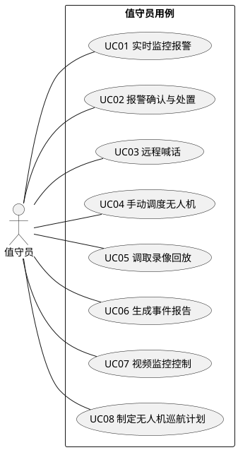
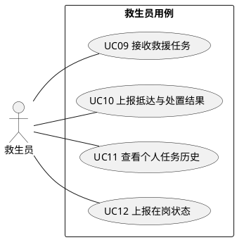
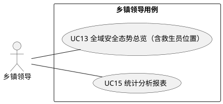
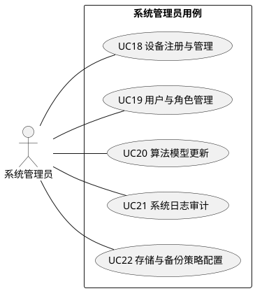
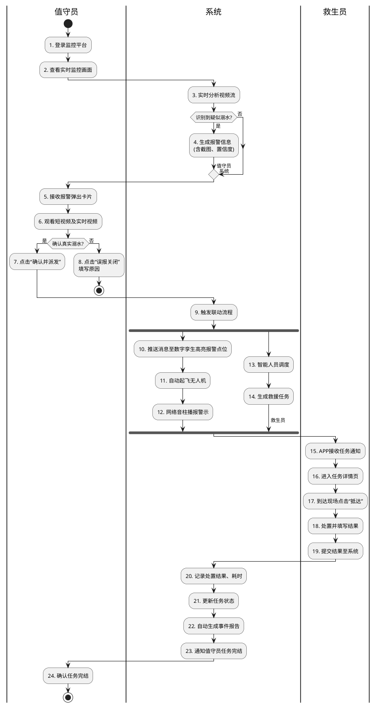
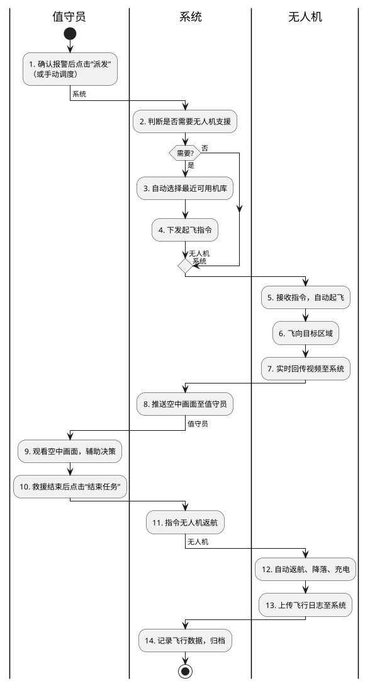
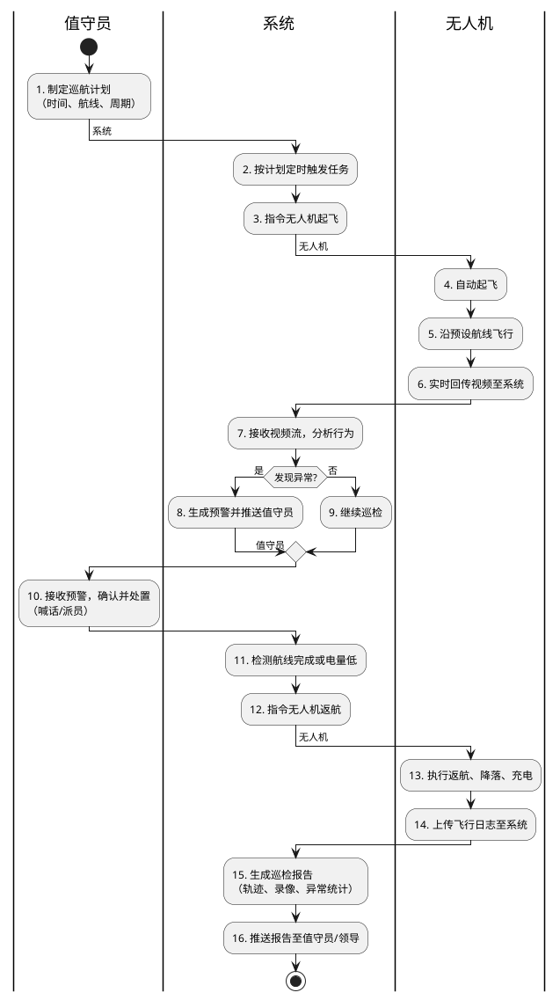
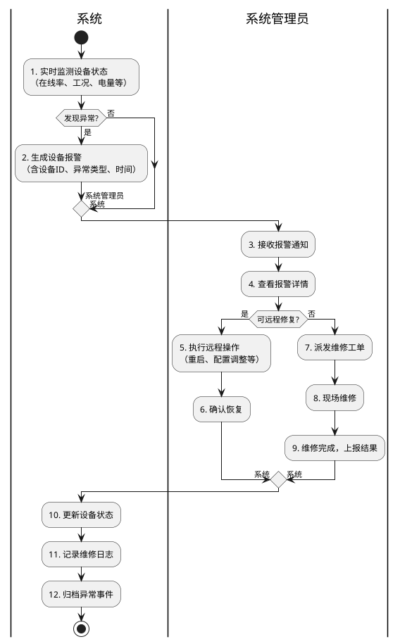
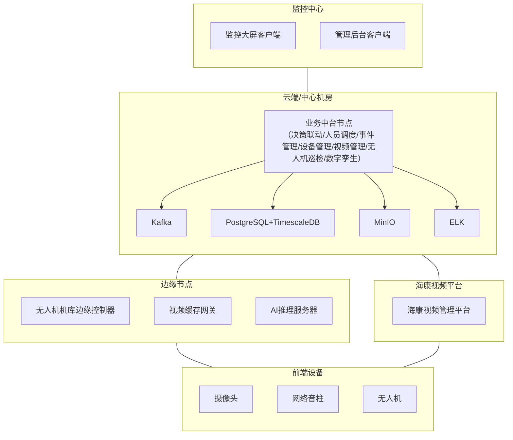
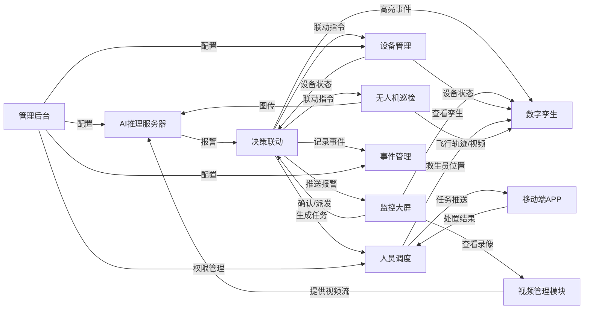

# 黄村乡 AI 防溺水智能管理系统 – 软件设计说明书

[TOC]

## 第一部分：需求分析

### 1. 引言

#### 1.1 项目背景

黄村乡水域面积广、人流量大，溺水事故风险高。传统的人工监控和巡查方式存在响应慢、覆盖不全、信息传递滞后等问题。本项目拟通过 AI 视觉识别、无人机自动巡检、物联网联动、数字孪生等先进技术，构建一套“感知—分析—决策—联动—处置”全流程闭环的智能防溺水管理系统，提升水域安全管理水平。

#### 1.2 建设目标

- **实时预警**：AI 自动识别溺水行为，报警延迟 ≤3 秒。
- **快速响应**：从报警到任务派发 ≤5 秒，无人机自动起飞 ≤30 秒。
- **全域覆盖**：重点水域视频监控全覆盖，无人机巡检补充盲区。
- **可视调度**：数字孪生平台实时展示水域态势、设备状态、人员位置。
- **闭环处置**：报警 → 确认 → 任务派发 → 现场救援 → 结果反馈 → 归档溯源。

#### 1.3 适用范围

本系统适用于黄村乡所有重点水域及沿岸区域，服务对象包括救生员、值守员、乡镇领导及系统管理员。

### 2. 用户角色定义

| 角色    | 说明       | 典型职责                                             |
| ----- | -------- | ------------------------------------------------ |
| 救生员   | 现场救援人员   | 接收救援任务、快速到达、执行救援、反馈结果、上报在岗状态                     |
| 值守员   | 监控中心值机人员 | 实时监控报警、人工确认、远程喊话、手动调度无人机、调取录像、生成事件报告、视频控制、制定巡航计划 |
| 乡镇领导  | 乡镇级管理人员  | 查看全域态势（含救生员位置）、统计分析报表                            |
| 系统管理员 | 平台运维人员   | 设备注册、用户权限、算法更新、日志审计、存储备份配置                       |

### 3. 业务需求

1. **降低溺水事故率**：通过主动预警和快速联动，将溺水事故发生率降低 50%以上。
2. **提高救援响应速度**：从报警到救生员抵达现场的时间缩短至 3 分钟以内。
3. **提升水域管理效率**：自动化巡检替代人工巡查，每日巡检覆盖率提升至 100%。
4. **实现过程可溯**：所有报警、处置、设备操作均有完整日志与录像证据链。

### 4. 用户需求（用例分析）

#### 4.1 值守员用例

##### 4.1.1 值守员用例图

##### 4.1.2 值守员用例说明

###### 用例 UC01：实时监控报警

| 项目   | 内容                                                                    |
| ---- | --------------------------------------------------------------------- |
| 用例名称 | 实时监控报警                                                                |
| 参与者  | 值守员                                                                   |
| 前置条件 | 值守员已登录监控平台                                                            |
| 触发事件 | AI 自动分析视频流，识别到疑似溺水行为                                                  |
| 基本流程 | 1. 平台大屏上高亮显示报警点位，弹出报警卡片（含截图、置信度、实时视频） 2. 系统发出声音提醒 3. 值守员可查看报警详情 |
| 后置条件 | 报警信息暂存待确认                                                             |

###### 用例 UC02：报警确认与处置

| 项目   | 内容                                                                                                       |
| ---- | -------------------------------------------------------------------------------------------------------- |
| 用例名称 | 报警确认与处置                                                                                                  |
| 参与者  | 值守员                                                                                                      |
| 前置条件 | 已有未确认的 AI 报警                                                                                             |
| 触发事件 | 值守员点击报警卡片进行确认                                                                                            |
| 基本流程 | 1. 值守员观看报警短视频和实时视频 2. 判断是否真实溺水 3. 若真实，点击“确认并派发”，系统自动进入联动流程（包括自动生成任务派发给救生员） 4. 若误报，点击“误报关闭”，填写原因 |
| 后置条件 | 报警状态更新（已确认/已关闭）；若确认，触发决策智能体并派发任务                                                                         |

###### 用例 UC03：远程喊话

| 项目   | 内容                                                                                            |
| ---- | --------------------------------------------------------------------------------------------- |
| 用例名称 | 远程喊话                                                                                          |
| 参与者  | 值守员                                                                                           |
| 前置条件 | 事发水域附近已部署网络音柱，且设备在线                                                                           |
| 触发事件 | 值守员在报警详情或设备管理界面点击“喊话”                                                                         |
| 基本流程 | 1. 选择音柱设备（系统推荐最近设备） 2. 选择预置语音或输入自定义文本转语音 3. 点击“播放”，音频通过音柱广播 4. 可选“实时喊话”：值守员对着麦克风直接喊话 |
| 后置条件 | 记录喊话操作日志（含时间、内容、操作人）                                                                          |

###### 用例 UC04：手动调度无人机

| 项目   | 内容                                                                                      |
| ---- | --------------------------------------------------------------------------------------- |
| 用例名称 | 手动调度无人机                                                                                 |
| 参与者  | 值守员                                                                                     |
| 前置条件 | 至少一个无人机机库在线，无人机电量充足                                                                     |
| 触发事件 | 值守员认为需要无人机支援（如报警模糊或需巡查周边）                                                               |
| 基本流程 | 1. 在数字孪生地图上框选目标区域 2. 系统自动推荐最近机库 3. 设置飞行高度、停留时间等参数 4. 点击“起飞”，无人机自动前往目标区域，实时回传视频 |
| 后置条件 | 无人机执行任务；平台记录手动调度日志；若调度时选择喊话，自动触发 UC03                                                   |

###### 用例 UC05：调取录像回放

| 项目   | 内容                                                                   |
| ---- | -------------------------------------------------------------------- |
| 用例名称 | 调取录像回放                                                               |
| 参与者  | 值守员                                                                  |
| 前置条件 | 已有摄像机接入且录像已存储                                                        |
| 触发事件 | 值守员需要查看历史录像                                                          |
| 基本流程 | 1. 在视频管理界面选择摄像机 2. 选择日期和时间段 3. 系统检索并播放录像 4. 支持拖动进度条、截图、下载片段 |
| 后置条件 | 无                                                                    |

###### 用例 UC06：生成事件报告

| 项目   | 内容                                                                                              |
| ---- | ----------------------------------------------------------------------------------------------- |
| 用例名称 | 生成事件报告                                                                                          |
| 参与者  | 值守员                                                                                             |
| 前置条件 | 报警事件已完成处置（真实溺水或误报）                                                                              |
| 触发事件 | 值守员点击“生成报告”                                                                                     |
| 基本流程 | 1. 系统自动汇总事件信息：时间、地点、报警视频、处置过程、人员日志 2. 值守员可补充文字说明 3. 点击“生成”，系统输出 PDF/Word 报告 4. 支持下载或打印 |
| 后置条件 | 报告存档至事件记录                                                                                       |

###### 用例 UC07：视频监控控制❓

| 项目   | 内容                                                                                                                                              |
| ---- | ----------------------------------------------------------------------------------------------------------------------------------------------- |
| 用例名称 | 视频监控控制                                                                                                                                          |
| 参与者  | 值守员                                                                                                                                             |
| 前置条件 | 值守员已打开实时监控画面                                                                                                                                    |
| 触发事件 | 值守员需要对当前视频进行操作                                                                                                                                  |
| 基本流程 | 1. 选择当前正在观看的摄像机 2. 点击“变焦+”/“变焦-”放大或缩小画面 3. 点击云台方向键（上下左右）转动摄像头角度 4. 点击“预置位”快速切换到预设角度 5. 切换显示布局（单画面/四画面/九画面） 6. 点击其他摄像机列表，切换当前监控画面 |
| 后置条件 | 操作记录到日志；画面实时更新                                                                                                                                  |

###### 用例 UC08：制定无人机巡航计划

| 项目   | 内容                                                                                                                                           |
| ---- | -------------------------------------------------------------------------------------------------------------------------------------------- |
| 用例名称 | 制定无人机巡航计划                                                                                                                                    |
| 参与者  | 值守员                                                                                                                                          |
| 前置条件 | 已有机库和无人机在线，系统支持航线规划                                                                                                                          |
| 触发事件 | 值守员需要设置日常自动巡检任务                                                                                                                              |
| 基本流程 | 1. 进入无人机巡检计划界面 2. 在地图上绘制巡航航线（支持多航点） 3. 设置巡航时间（立即执行/定时/周期：每天/每周） 4. 设置巡航参数（飞行高度、速度、任务优先级） 5. 保存计划，系统自动安排无人机执行 6. 可修改、暂停、删除已有计划 |
| 后置条件 | 系统按计划自动起飞巡检；生成巡检记录                                                                                                                           |

#### 4.2 救生员用例

##### 4.2.1 救生员用例图

##### 4.2.2 救生员用例说明

###### 用例 UC09：接收救援任务

| 项目   | 内容                                                                                                                                       |
| ---- | ---------------------------------------------------------------------------------------------------------------------------------------- |
| 用例名称 | 接收救援任务                                                                                                                                   |
| 参与者  | 救生员                                                                                                                                      |
| 前置条件 | 救生员已登录移动端 APP 且状态为“在岗”；AI 报警已经值守员确认并生成救援任务                                                                                               |
| 触发事件 | 值守员确认报警后，系统自动派发任务                                                                                                                        |
| 基本流程 | 1. 系统向救生员 APP 推送任务通知（标题、紧急程度） 2. 救生员点击通知进入任务详情页 3. 详情页展示：事发位置地图、现场截图、推荐路径、关联设备 4. 到达现场后点击“抵达”按钮 5. 处置完成后填写结果（救援成功/劝离/误报等）并提交 |
| 后置条件 | 任务状态更新为“已完成”；系统记录处置耗时与结果；事件归档                                                                                                            |

###### 用例 UC10：上报抵达与处置结果

| 项目   | 内容                                                                                          |
| ---- | ------------------------------------------------------------------------------------------- |
| 用例名称 | 上报抵达与处置结果                                                                                   |
| 参与者  | 救生员                                                                                         |
| 前置条件 | 救生员已到达事发地点                                                                                  |
| 触发事件 | 救生员点击“抵达”按钮或处置完成后提交                                                                         |
| 基本流程 | 1. 救生员点击“抵达”，系统记录到达时间 2. 处置完成后，选择处置结果类型（救援成功、劝离、误报、需增援） 3. 可补充文字说明或现场照片 4. 提交结果至系统 |
| 后置条件 | 任务状态更新；通知值守员任务完结；更新救生员绩效数据                                                                  |

###### 用例 UC11：查看个人任务历史

| 项目   | 内容                                                                               |
| ---- | -------------------------------------------------------------------------------- |
| 用例名称 | 查看个人任务历史                                                                         |
| 参与者  | 救生员                                                                              |
| 前置条件 | 救生员已登录 APP                                                                       |
| 触发事件 | 救生员主动进入“历史任务”页面                                                                  |
| 基本流程 | 1. 选择时间范围（今日/本周/本月/自定义） 2. 系统展示任务列表：日期、地点、处置结果、耗时 3. 点击任一任务可查看详情（截图、路径、反馈） |
| 后置条件 | 无                                                                                |

###### 用例 UC12：上报在岗状态

| 项目   | 内容                                                                         |
| ---- | -------------------------------------------------------------------------- |
| 用例名称 | 上报在岗状态                                                                     |
| 参与者  | 救生员                                                                        |
| 前置条件 | 救生员已登录 APP                                                                 |
| 触发事件 | 救生员手动切换状态，或系统定时检测                                                          |
| 基本流程 | 1. 救生员点击“在岗”或“离岗”按钮 2. 系统记录状态变更时间及 GPS 位置 3. 若在岗，系统开始接收任务推送；若离岗，暂停推送 |
| 后置条件 | 系统更新救生员状态，任务调度算法据此决定是否派发                                                   |

#### 4.3 乡镇领导用例

##### 4.3.1 乡镇领导用例图

##### 4.3.2 乡镇领导用例说明

###### 用例 UC13：全域安全态势总览（含救生员位置）

| 项目   | 内容                                                                                                                                               |
| ---- | ------------------------------------------------------------------------------------------------------------------------------------------------ |
| 用例名称 | 全域安全态势总览（含救生员位置）                                                                                                                                 |
| 参与者  | 乡镇领导                                                                                                                                             |
| 前置条件 | 领导已登录系统（PC 或大屏）                                                                                                                                  |
| 触发事件 | 领导进入“态势总览”页面                                                                                                                                     |
| 基本流程 | 1. 数字孪生地图展示所有水域、摄像机、无人机、音柱、**救生员实时位置** 2. 右侧面板显示今日报警数、未处理任务、设备在线率 3. 点击任意救生员图标可查看其姓名、在岗状态、联系方式 4. 点击任意设备可查看详情 5. 支持切换热力图（人员密度、报警高发区） |
| 后置条件 | 无                                                                                                                                                |

###### 用例 UC15：统计分析报表

| 项目   | 内容                                                                                    |
| ---- | ------------------------------------------------------------------------------------- |
| 用例名称 | 统计分析报表                                                                                |
| 参与者  | 乡镇领导                                                                                  |
| 前置条件 | 系统已积累足够数据                                                                             |
| 触发事件 | 领导进入“统计报表”                                                                            |
| 基本流程 | 1. 选择统计维度（按日/周/月/年，按水域，按类型） 2. 查看图表：报警趋势、响应时长分布、无人机覆盖率、任务完成率 3. 可导出 Excel 或 PDF |
| 后置条件 | 无                                                                                     |

#### 4.4 系统管理员用例

##### 4.4.1 系统管理员用例图

##### 4.4.2 系统管理员用例说明

###### 用例 UC18：设备注册与管理

| 项目   | 内容                                                                                                                       |
| ---- | ------------------------------------------------------------------------------------------------------------------------ |
| 用例名称 | 设备注册与管理                                                                                                                  |
| 参与者  | 系统管理员                                                                                                                    |
| 前置条件 | 管理员已登录后台                                                                                                                 |
| 触发事件 | 新增设备或设备信息变更                                                                                                              |
| 基本流程 | 1. 进入设备管理页面，点击“注册设备” 2. 选择设备类型（摄像头/无人机机库/音柱等） 3. 填写设备 ID、IP 地址、安装位置、预置位参数 4. 测试连接，成功后保存 5. 已注册设备支持修改、删除、批量导出 |
| 后置条件 | 设备在平台中可见，状态监控启动                                                                                                          |

###### 用例 UC19：用户与角色管理

| 项目   | 内容                                                                                                                |
| ---- | ----------------------------------------------------------------------------------------------------------------- |
| 用例名称 | 用户与角色管理                                                                                                           |
| 参与者  | 系统管理员                                                                                                             |
| 前置条件 | 管理员已登录                                                                                                            |
| 触发事件 | 新增/修改/删除用户或角色                                                                                                     |
| 基本流程 | 1. 进入用户管理，点击“新增用户” 2. 填写姓名、手机号、角色（救生员/值守员/领导） 3. 分配可访问的设备或水域范围 4. 设置初始密码，用户首次登录强制修改 5. 角色权限可自定义（增删改查） |
| 后置条件 | 用户可使用系统                                                                                                           |

###### 用例 UC20：算法模型更新

| 项目   | 内容                                                                                                                                        |
| ---- | ----------------------------------------------------------------------------------------------------------------------------------------- |
| 用例名称 | 算法模型更新                                                                                                                                    |
| 参与者  | 系统管理员                                                                                                                                     |
| 前置条件 | 获得新版本的 AI 模型文件                                                                                                                            |
| 触发事件 | 需要升级溺水识别算法                                                                                                                                |
| 基本流程 | 1. 进入“算法管理”页面，点击“模型上传” 2. 选择.pt/.onnx 等模型文件 3. 系统校验模型兼容性 4. 选择部署的边缘节点（多个算力服务器） 5. 点击“热部署”，模型动态加载，不影响现有视频流 6. 验证新模型识别效果，可回滚 |
| 后置条件 | 新模型生效                                                                                                                                     |

###### 用例 UC21：系统日志审计

| 项目   | 内容                                                                                       |
| ---- | ---------------------------------------------------------------------------------------- |
| 用例名称 | 系统日志审计                                                                                   |
| 参与者  | 系统管理员                                                                                    |
| 前置条件 | 系统运行中                                                                                    |
| 触发事件 | 管理员需要排查问题或合规审计                                                                           |
| 基本流程 | 1. 进入日志审计页面 2. 筛选条件：时间范围、模块（报警/设备/用户）、操作类型 3. 查看日志列表：时间、用户、操作、IP、结果 4. 支持导出日志文件 |
| 后置条件 | 无                                                                                        |

###### 用例 UC22：存储与备份策略配置

| 项目   | 内容                                                                                                                                        |
| ---- | ----------------------------------------------------------------------------------------------------------------------------------------- |
| 用例名称 | 存储与备份策略配置                                                                                                                                 |
| 参与者  | 系统管理员                                                                                                                                     |
| 前置条件 | 存储系统已挂载                                                                                                                                   |
| 触发事件 | 需要设置录像保留周期或备份计划                                                                                                                           |
| 基本流程 | 1. 进入存储配置页面 2. 设置重要水域录像保留天数（如 30 天） 3. 设置普通水域录像保留天数（如 7 天） 4. 开启自动备份：选择备份目标（NAS/云存储）、备份时间（凌晨） 5. 设置存储容量预警阈值（如 85%） 6. 保存策略 |
| 后置条件 | 系统按策略自动清理和备份                                                                                                                              |

### 5. 功能需求

#### F-01 AI 实时行为分析

- **功能描述**：基于深度学习的视觉 AI 分析引擎，支持对人形目标进行实时行为分析。
- **输入**：实时视频流（支持 4K，多路并发）
- **输出**：结构化行为标签（正常/嬉水/溺水等）
- **前置条件**：视频流已接入系统
- **关联用例**：UC01（实时监控报警）

#### F-02 溺水行为识别

- **功能描述**：通过人体姿态估计与时序动作识别，准确识别溺水特征（垂直挣扎、手臂不规则挥动、长时间沉没等），并能可靠区分正常游泳、潜水、嬉水等行为。
- **输入**：视频流中的连续帧序列
- **输出**：溺水置信度、报警标志、截图与短视频片段
- **前置条件**：AI 实时行为分析已启用
- **关联用例**：UC01、UC02

#### F-03 多路视频并发处理

- **功能描述**：支持至少 50 路视频流的实时分析，兼容 4K 分辨率，保证低延迟（≤3 秒）。
- **输入**：多路视频流
- **输出**：每路视频的分析结果
- **前置条件**：足够的边缘计算资源
- **关联用例**：UC01

#### F-04 环境自适应抗干扰

- **功能描述**：融合场景自适应算法，降低波浪反光、光照变化等环境干扰造成的误报。
- **输入**：视频流及环境光传感器数据（可选）
- **输出**：去噪后的行为分析结果
- **前置条件**：无
- **关联用例**：UC01、UC02

#### F-05 自动报警生成与推送

- **功能描述**：识别到溺水事件后，自动生成报警信息，关联最近摄像机画面与位置坐标，并推送给值守员。
- **输入**：AI 识别的溺水事件
- **输出**：报警记录（含位置、置信度、截图、短视频）
- **前置条件**：AI 已判定溺水
- **关联用例**：UC01、UC02

#### F-06 决策联动引擎

- **功能描述**：事件驱动的自动化决策引擎，实现报警 → 处置闭环联动。报警触发后自动执行：消息推送、无人机自主起飞、数字孪生高亮、音柱播报警示。
- **输入**：确认后的报警事件
- **输出**：联动指令（无人机、音柱、数字孪生）
- **前置条件**：报警已确认
- **关联用例**：UC02、UC04、UC08

#### F-07 智能人员调度

- **功能描述**：基于报警位置和救生员实时分布（在岗状态、距离、可达性、忙碌度），自动计算最优派遣方案，支持单事件多人员协同及多事件并发动态重分配。任务通过 APP 推送，包含位置、截图、最优路径。
- **输入**：报警位置、救生员列表及状态
- **输出**：救援任务（派发给指定救生员）
- **前置条件**：报警已确认
- **关联用例**：UC02、UC09、UC10

#### F-08 事件溯源与回放

- **功能描述**：以时间轴形式记录报警发生前后关键时段的主视频、关联点位录像及抓图，支持回放事件全过程。
- **输入**：报警事件 ID
- **输出**：时间轴视频/图片序列
- **前置条件**：录像已存储
- **关联用例**：UC05、UC06

#### F-09 视频实时预览与云台控制

- **功能描述**：提供实时预览、云台操控、录像回放、视频上墙等功能。
- **输入**：用户操作指令（云台方向、变焦、预置位）
- **输出**：视频画面变化
- **前置条件**：摄像机在线且用户有权限
- **关联用例**：UC07

#### F-10 视频接入与存储管理

- **功能描述**：兼容主流品牌摄像机，支持大规模接入，兼容 4K。重要水域录像按策略长期保存，支持存储容量预警。
- **输入**：摄像机配置信息、存储策略
- **输出**：录像文件、存储状态
- **前置条件**：存储系统已挂载
- **关联用例**：UC22

#### F-11 统一设备管理

- **功能描述**：对无人机、视频监控、物联网设备统一注册与状态管理。实时监测设备在线率、运行工况，异常即时报警。
- **输入**：设备信息（ID、类型、IP、位置）
- **输出**：设备状态、异常报警
- **前置条件**：管理员权限
- **关联用例**：UC18

#### F-12 摄像机预置位联动

- **功能描述**：支持摄像机预置位管理与联动，可随报警或应急流程自动转向目标区域。
- **输入**：报警位置坐标
- **输出**：摄像机转动到预置位
- **前置条件**：预置位已配置
- **关联用例**：UC02、UC07

#### F-13 网络音柱远程广播

- **功能描述**：管理网络音柱设备，支持远程预置语音播报和实时喊话。
- **输入**：语音文本或实时音频
- **输出**：音柱广播
- **前置条件**：音柱在线且值守员权限
- **关联用例**：UC03

#### F-14 无人机自动机库管理

- **功能描述**：管理自动机库及无人机，支持航线上传、任务规划与执行。监控无人机实时飞行状态（位置、高度、速度）、视频图传、剩余电量，异常自动返航。
- **输入**：航线文件、任务计划
- **输出**：飞行控制指令、状态数据
- **前置条件**：机库已注册并在线
- **关联用例**：UC04、UC08

#### F-15 无人机远程指令控制

- **功能描述**：接收平台远程指令，可执行起飞、返航、悬停、定点飞行等动作。
- **输入**：指令（起飞/返航/悬停/飞向坐标）
- **输出**：无人机动作
- **前置条件**：无人机在线且电量充足
- **关联用例**：UC04

#### F-16 无人机视频实时回传与分析

- **功能描述**：巡航过程中将视频画面实时回传平台，由 AI 识别与决策算法进行人员行为分析及违规识别。
- **输入**：无人机视频流
- **输出**：行为分析结果、报警
- **前置条件**：无人机已起飞
- **关联用例**：UC04、UC08

#### F-17 无人机巡检记录与报告

- **功能描述**：保存每次飞行轨迹、录像及操作日志，生成巡检报告，支持按区域、时段统计覆盖率与问题发现情况。
- **输入**：巡检计划、飞行数据
- **输出**：巡检报告、统计数据
- **前置条件**：已完成至少一次飞行
- **关联用例**：UC08、UC13（领导查看报告）

#### F-18 人员信息与角色管理

- **功能描述**：人员信息录入、角色分配、权限管理。包括救生员、值守员、乡镇领导、系统管理员。
- **输入**：用户信息、角色权限配置
- **输出**：用户账号、权限集
- **前置条件**：管理员权限
- **关联用例**：UC19

#### F-19 救生员实时位置与在岗管理

- **功能描述**：救生员实时位置监测和在岗状态管理，为任务调度提供依据。
- **输入**：救生员 GPS 位置、手动状态切换
- **输出**：位置地图、在岗状态标志
- **前置条件**：救生员已登录 APP 并授权位置
- **关联用例**：UC12、UC13

#### F-20 任务跟踪与绩效记录

- **功能描述**：接收决策智能体派发的救援任务，跟踪到达时间与处置结果，记录值守员对报警的确认时间、处理过程，形成工作记录与绩效数据。
- **输入**：任务状态更新、处置结果
- **输出**：绩效报表、任务日志
- **前置条件**：任务已派发
- **关联用例**：UC10、UC11、UC15

#### F-21 流域数字孪生可视化

- **功能描述**：基于 GIS 和三维建模技术，对水域、岸线、建筑、设备进行高精度数字孪生重构。网页端轻量化三维可视化平台，支持视角缩放、漫游、定点查看。
- **输入**：地理信息、设备坐标、模型数据
- **输出**：三维场景渲染
- **前置条件**：系统已部署三维引擎
- **关联用例**：UC13

#### F-22 流体仿真与危险水域标注

- **功能描述**：嵌入流体仿真算法，动态复现河道水流状态（急流、回水湾、暗流等），直观呈现溺水高危区域。
- **输入**：水文数据、河道地形
- **输出**：水流动态模拟图层
- **前置条件**：已构建数字孪生底图
- **关联用例**：UC13

#### F-23 动态数据映射与报警高亮

- **功能描述**：实时映射摄像机视域、无人机轨迹、救生员定位、设备状态、报警点位，并在孪生场景中高亮显示。
- **输入**：设备实时数据、报警事件
- **输出**：场景中动态标签/高亮
- **前置条件**：数字孪生平台运行中
- **关联用例**：UC13

#### F-24 移动端分级登录与专属菜单

- **功能描述**：分级角色权限登录（救生员、网格员、乡镇领导），菜单与数据隔离。
- **输入**：用户账号、角色
- **输出**：对应权限的功能界面
- **前置条件**：用户已在后台注册
- **关联用例**：UC19

#### F-25 移动端预警接收与导航

- **功能描述**：救生员实时接收 AI 预警，一键定位事发水域坐标，快速发起救援。
- **输入**：报警推送
- **输出**：地图导航、任务详情
- **前置条件**：救生员在岗且 APP 在线
- **关联用例**：UC09、UC10

#### F-26 移动端监控点位查看与任务督办

- **功能描述**：领导可地图查看摄像头布设位置、在线状态、覆盖范围；任务督办管理（查看巡查、隐患整改、救援等任务进度，支持签收、流转、反馈）。
- **输入**：设备状态数据、任务列表
- **输出**：地图标注、任务操作界面
- **前置条件**：领导权限账号
- **关联用例**：UC13

### 6. 业务流程

#### 6.1 溺水应急处理流程（多泳道带步骤编号）

##### 流程步骤说明（编号与图一致，多步合并描述）

| 步骤编号  | 执行角色 | 操作说明                                          |
| ----- | ---- | --------------------------------------------- |
| 1-2   | 值守员  | 登录监控平台，查看实时监控画面                               |
| 3-4   | 系统   | 实时分析视频流，若识别到疑似溺水则生成报警信息并推送至值守员；否则继续分析         |
| 5-6   | 值守员  | 接收报警卡片，观看短视频及实时视频                             |
| 7     | 值守员  | 确认真实溺水后点击“确认并派发”；若为误报则执行步骤 8                  |
| 8     | 值守员  | 误报：点击“误报关闭”并填写原因，流程结束                         |
| 9-14  | 系统   | 触发联动流程：数字孪生高亮、无人机起飞、音柱告警、智能人员调度、生成救援任务并推送给救生员 |
| 15-19 | 救生员  | APP 接收任务，到达现场点击“抵达”，处置完成后提交结果至系统              |
| 20-23 | 系统   | 记录处置结果，更新任务状态，自动生成事件报告，通知值守员                  |
| 24    | 值守员  | 确认任务完结                                        |

#### 6.2 无人机应急联动流程（多泳道带步骤编号）

##### 流程步骤说明（编号与图一致，多步合并描述）

| 步骤编号  | 执行角色     | 操作说明                            |
| ----- | -------- | ------------------------------- |
| 1     | 值守员      | 确认报警后点击“派发”或手动调度无人机             |
| 2-4   | 系统       | 判断是否需要无人机支援；若需要，自动选择最近机库并下发起飞指令 |
| 5-7   | 无人机      | 接收指令自动起飞，飞向目标区域，实时回传视频至系统       |
| 8     | 系统       | 将空中画面推送给值守员                     |
| 9-10  | 值守员      | 观看空中画面辅助决策，救援结束后点击“结束任务”        |
| 11-13 | 系统 / 无人机 | 系统指令返航，无人机自动返航、降落、充电，上传飞行日志     |
| 14    | 系统       | 记录飞行数据，归档                       |

#### 6.3 日常无人机巡检流程（多泳道带步骤编号）

##### 流程步骤说明（编号与图一致，多步合并描述）

| 步骤编号  | 执行角色 | 操作说明                               |
| ----- | ---- | ---------------------------------- |
| 1     | 值守员  | 制定巡航计划（时间、航线、周期）                   |
| 2-3   | 系统   | 按计划定时触发任务，指令无人机起飞                  |
| 4-6   | 无人机  | 自动起飞，沿预设航线飞行，实时回传视频至系统             |
| 7-9   | 系统   | 接收视频流，分析行为；若发现异常则生成预警并推送值守员；否则继续巡检 |
| 10    | 值守员  | 接收预警，确认并处置（喊话/派员）                  |
| 11-12 | 系统   | 检测航线完成或电量低，指令无人机返航                 |
| 13-14 | 无人机  | 执行返航、降落、充电，上传飞行日志至系统               |
| 15-16 | 系统   | 生成巡检报告（含轨迹、录像、异常统计），推送至值守员/领导      |

#### 6.4 设备异常处置流程（多泳道带步骤编号）

##### 流程步骤说明（编号与图一致，多步合并描述）

| 步骤编号  | 执行角色  | 操作说明                                                      |
| ----- | ----- | --------------------------------------------------------- |
| 1-2   | 系统    | 实时监测设备状态（在线率、工况、电量等）；发现异常则生成设备报警（含设备 ID、异常类型、时间）并推送给系统管理员 |
| 3-4   | 系统管理员 | 接收报警通知，查看报警详情                                             |
| 5-6   | 系统管理员 | 若可远程修复，执行远程操作（重启、配置调整等），确认恢复后系统更新状态                       |
| 7-9   | 系统管理员 | 若无法远程修复，派发维修工单，现场维修，完成后上报结果                               |
| 10-12 | 系统    | 更新设备状态，记录维修日志，归档异常事件                                      |

### 7. 非功能需求

#### NF-01 性能要求

- **描述**：系统应保证报警与响应的实时性，满足水域监控场景的高并发需求。
- **指标要求**：
  - 报警端到端延迟 ≤ 3 秒
  - 支持 ≥ 50 路视频实时并发分析（4K 分辨率）
- **优先级**：高

#### NF-03 安全性要求

- **描述**：系统应保障数据安全、访问控制与操作审计。
- **指标要求**：
  - 用户角色权限隔离，最小权限原则
  - 所有关键操作（报警确认、任务派发、设备控制）记录操作日志，日志保留 ≥ 180 天
  - 视频流存储应防止未授权访问
- **优先级**：高

#### NF-04 可扩展性要求

- **描述**：系统应支持未来新增设备类型、算法模型和功能模块。
- **指标要求**：
  - 新增设备类型（如新型无人机、传感器）可通过配置接入，无需修改核心代码
  - AI 识别算法模型支持热部署（不影响已有视频流分析）
  - 视频接入能力可水平扩展（增加边缘节点即可提升并发路数）
- **优先级**：中

#### NF-07 可维护性要求

- **描述**：系统应便于运维人员排查故障和升级。
- **指标要求**：
  - 提供统一的管理后台，查看设备状态、日志、性能指标
  - 支持远程日志导出
  - 核心模块（AI 分析、视频存储）应支持滚动升级，不中断服务
- **优先级**：中

## 第二部分：系统设计

### 8. 系统总体架构

#### 8.1 系统总体架构图（最终版）

#### 8.2 各层职责详解

##### 8.2.1 感知层

感知层是系统的基础数据采集与指令执行层，直接与物理环境交互。

- **摄像头**：部署于重点水域及沿岸，采集实时视频流，支持 4K 分辨率、夜视、云台控制。视频流通过 RTSP/GB28181 协议上传至边缘缓存或海康平台。
- **网络音柱**：布设于危险水域附近，接收平台下发的语音指令，进行预置语音播报或实时喊话，用于警示、驱离。
- **无人机**：执行自动巡检或应急任务，搭载高清摄像头、图传模块。接收平台指令（起飞、悬停、返航、航线飞行），实时回传视频和飞行状态（位置、高度、电量）。机库作为无人机的载体，提供自动充电、存放和任务调度。

##### 8.2.2 边缘计算层

边缘计算层部署于靠近感知设备的网络边缘，负责数据缓存、本地控制及实时响应，降低对云端带宽和延迟的依赖。

- **无人机机库（边缘控制）**：管理无人机的自动起降、充电、航线加载。与平台保持通信，接收任务指令并反馈执行状态。在通信中断时，可暂存任务并自主决策安全返航。
- **视频缓存网关**：临时缓存最近 1-2 小时的视频流，供 AI 推理服务器拉取分析。不进行长期存储，录像持久化由海康平台负责。
- **AI 推理服务器**：部署在边缘节点，配置 GPU，负责实时视频分析、溺水识别，输出报警信息。不上云，以降低延迟和带宽占用。

##### 8.2.3 平台层

平台层是系统的核心大脑，部署在云中心或数据中心，分为三个中台，提供业务逻辑、数据服务和 AI 能力。

**数据中台**：

- **Kafka**：消息队列，解耦各模块间异步通信，如报警事件、任务派发、设备状态变更等。
- **PostgreSQL+TimescaleDB**：存储关系数据（设备、用户、事件、任务）及时序数据（设备状态、位置轨迹），支持高效查询与聚合。
- **MinIO**：对象存储，保存报警截图、短视频片段、巡检报告、事件报告、模型文件等非结构化数据（不保存原始录像）。
- **ELK**：日志服务，收集全系统操作日志、异常日志，支持检索、分析和审计。

**AI 中台**（此处为逻辑分组，物理上已置于边缘节点）：

- **AI 推理服务器**（已归入边缘层）负责推理；模型仓库、模型部署等能力可视为平台层功能，但为简化，此处不再单独列出。

**业务中台**（业务中台节点）：

- **决策联动**：接收报警事件，按预设规则触发联动（如自动起飞无人机、播放音柱、高亮数字孪生）。
- **人员调度**：基于报警位置和救生员实时分布，计算最优派遣方案，生成救援任务并通过移动端下发。
- **事件管理**：管理报警事件的全生命周期（发生、确认、处置、归档），支持事件溯源与报告生成。
- **设备管理**：统一注册、监控、控制前端设备（摄像头、音柱、无人机机库），实时维护设备状态，提供预置位联动。
- **视频管理**：对接海康平台，实现视频实时预览、云台控制、录像检索与回放、视频上墙等功能。
- **无人机巡检**：航线规划、任务调度、飞行状态监控、图传接收、巡检报告生成。
- **数字孪生**：三维场景构建、实时数据映射（设备/人员位置）、水流模拟、报警高亮，提供可视化服务接口。

##### 8.2.4 应用层

应用层是最终用户接触的交互界面，提供可视化的管理和指挥工具。

- **监控大屏**：供值守员集中监控，展示报警实时滚动、GIS 地图、设备状态、多路视频窗口，支持报警确认、派发、喊话，可集成数字孪生视图。
- **移动端 APP**：救生员任务接收、导航、处置上报、在岗状态切换；领导查看统计报表、任务督办。
- **管理后台**：供系统管理员进行设备注册、用户权限管理、算法模型更新、日志审计、存储策略配置。

### 9. 核心模块设计

#### 9.1 模块划分

| 模块名称                    | 所属中台/层 | 职责                                               |
| ----------------------- | ------ | ------------------------------------------------ |
| AI 推理服务器（含算法仓库、模型部署、推理） | 边缘节点   | 实时接收视频流，调用模型进行推理，输出报警信息（含置信度、截图、短视频）             |
| 决策联动                    | 业务中台   | 事件驱动联动，根据报警规则自动调度无人机、音柱、数字孪生                     |
| 人员调度                    | 业务中台   | 基于报警位置和救生员实时状态计算最优派遣方案，生成救援任务                    |
| 事件管理                    | 业务中台   | 报警事件全生命周期管理（生成、确认、处置、归档），支持溯源与报告                 |
| 设备管理                    | 业务中台   | 统一注册、监控、控制前端设备（摄像头、音柱、无人机机库），异常报警                |
| 视频管理                    | 业务中台   | 视频实时预览、云台控制、录像检索与回放（对接海康平台）                      |
| 无人机巡检                   | 业务中台   | 航线规划、任务调度、飞行状态监控、图传接收、巡检报告生成                     |
| 数字孪生                    | 业务中台   | 三维场景构建、实时数据映射（设备/人员位置）、水流模拟、报警高亮                 |
| 监控大屏                    | 应用层    | 值守员集中监控，展示报警实时滚动、GIS 地图、设备状态、多路视频窗口，支持报警确认、派发、喊话 |
| 移动端 APP                 | 应用层    | 救生员任务接收、导航、处置上报、在岗状态；领导查看统计报表、任务督办               |
| 管理后台                    | 应用层    | 系统管理员进行设备注册、用户权限、算法更新、日志审计、存储配置                  |

#### 9.2 模块间交互关系

#### 9.3 核心模块详细设计（所有模块）

##### 1. AI 推理服务器

- **输入**：实时视频流（RTSP/GB28181）、分析参数
- **处理流程**：
  1. 从视频缓存网关获取视频流解码为帧序列。
  2. 调用模型进行人体检测、姿态估计、时序动作识别。
  3. 识别溺水行为，当置信度超过阈值时生成报警信息（含目标位置、截图、短视频片段）。
  4. 将报警推送到 Kafka，供决策联动模块消费。
- **输出**：结构化报警数据（JSON）。
- **异常处理**：视频流中断时自动重连；模型推理超时则跳过当前帧。
- **性能约束**：单路 4K 视频分析延迟 ≤3 秒；支持 ≥50 路并发。

##### 2. 决策联动

- **输入**：确认后的报警事件
- **处理流程**：
  1. 接收报警事件（含位置、置信度、关联摄像机）。
  2. 并行执行联动：调用数字孪生高亮报警点；调用设备管理获取最近音柱播放语音；调用无人机巡检选择最近机库起飞。
  3. 调用人员调度生成救援任务并推送。
  4. 记录所有联动动作到事件管理模块。
- **输出**：联动执行状态、任务 ID。
- **异常处理**：某联动失败则记录并继续其他联动。
- **性能约束**：从接收到报警到联动指令下发完成 ≤2 秒。

##### 3. 人员调度

- **输入**：报警位置、事件优先级
- **处理流程**：
  1. 获取在岗救生员列表及实时位置、忙碌状态。
  2. 计算每个救生员到事发点的距离、预计到达时间，考虑忙碌度排序。
  3. 选择最优救生员，生成救援任务（含位置、截图、推荐路径）。
  4. 调用移动端推送接口下发任务，并启动超时计时器。
- **输出**：任务 ID、被派发救生员 ID。
- **异常处理**：无可用救生员时升级通知值守员。
- **性能约束**：单次调度计算 ≤500ms。

##### 4. 事件管理

- **输入**：报警事件、联动记录、人员处置结果
- **处理流程**：
  1. 生成全局唯一事件 ID，存储基本信息。
  2. 追加联动记录和人员处置结果。
  3. 提供事件查询、时间轴回放、报告生成接口。
- **输出**：事件归档记录、报告文件。
- **异常处理**：存储失败时重试 3 次。
- **性能约束**：事件写入延迟 ≤100ms，查询响应 ≤1 秒。

##### 5. 设备管理

- **输入**：设备注册信息、状态上报、控制指令
- **处理流程**：
  1. 设备注册：录入设备信息。
  2. 状态监控：接收心跳，更新在线状态，异常时生成报警。
  3. 控制指令：接收决策联动的指令，转发到对应设备。
- **输出**：设备状态变更、控制结果。
- **异常处理**：控制指令无响应时重试并记录。
- **性能约束**：状态更新延迟 ≤5 秒。

##### 6. 视频管理

- **输入**：摄像机视频流、用户操作
- **处理流程**：
  1. 通过 GB/T28181 或 SDK 从海康平台拉取视频流。
  2. 实现实时预览、云台控制、录像检索与回放。
  3. 为 AI 推理服务器提供视频流接口。
- **输出**：视频流、录像文件、控制执行状态。
- **异常处理**：录像检索失败时提示重试。
- **性能约束**：预览延迟 ≤1 秒，回放检索 ≤2 秒。

##### 7. 无人机巡检

- **输入**：巡检计划、手动指令
- **处理流程**：
  1. 计划管理：制定或修改巡航计划。
  2. 任务调度：定时触发，检查机库状态，发送起飞指令。
  3. 飞行监控：接收状态及图传视频，推送至 AI 分析。
  4. 任务结束：自动返航充电，生成巡检报告。
- **输出**：飞行日志、巡检报告。
- **异常处理**：机库不可用时跳过并通知。
- **性能约束**：从触发到起飞指令发出 ≤30 秒。

##### 8. 数字孪生

- **输入**：GIS 数据、设备状态、报警事件、救生员位置
- **处理流程**：
  1. 三维场景构建。
  2. 实时数据映射，动态更新标签和动画。
  3. 水流模拟与报警高亮。
  4. 提供可视化服务接口供监控大屏调用。
- **输出**：三维场景渲染数据、高亮事件。
- **异常处理**：数据源中断时显示最后已知状态。
- **性能约束**：场景加载 ≤5 秒，数据更新延迟 ≤1 秒。

##### 9. 监控大屏

- **输入**：值守员操作
- **处理流程**：
  1. 展示报警实时列表、GIS 地图（集成数字孪生）。
  2. 多路视频窗口。
  3. 报警确认、派发、喊话等操作。
  4. 历史查询与回放。
- **输出**：用户操作指令。
- **性能约束**：界面操作响应 ≤1 秒。

##### 10. 移动端 APP

- **输入**：救生员/领导操作
- **处理流程**：
  1. 分级登录，展示对应菜单。
  2. 救生员：接收任务、导航、上报处置、在岗状态切换。
  3. 领导：查看点位、统计报表、任务督办。
- **输出**：任务状态更新、位置上报、督办消息。
- **异常处理**：网络断线时缓存操作。
- **性能约束**：任务推送延迟 ≤5 秒，页面切换 ≤2 秒。

##### 11. 管理后台

- **输入**：管理员操作
- **处理流程**：
  1. 设备注册与管理。
  2. 用户与权限管理。
  3. 算法模型上传与部署。
  4. 日志审计与存储策略配置。
- **输出**：配置变更生效、日志文件。
- **性能约束**：列表查询响应 ≤2 秒，模型上传 ≤10MB/s。
